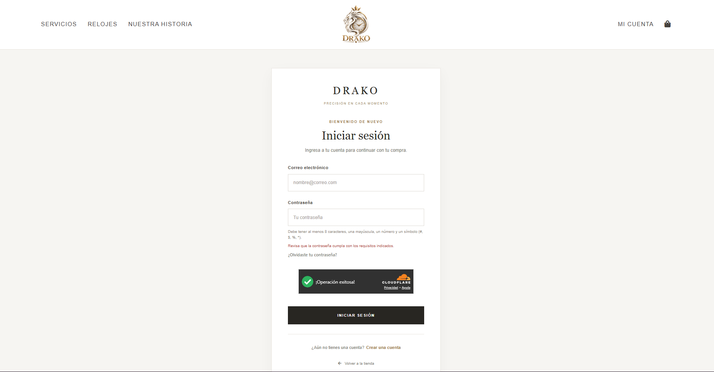
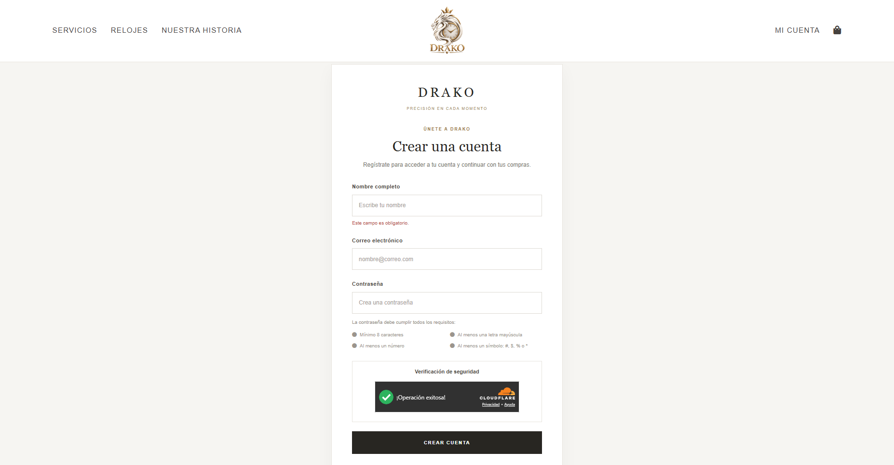
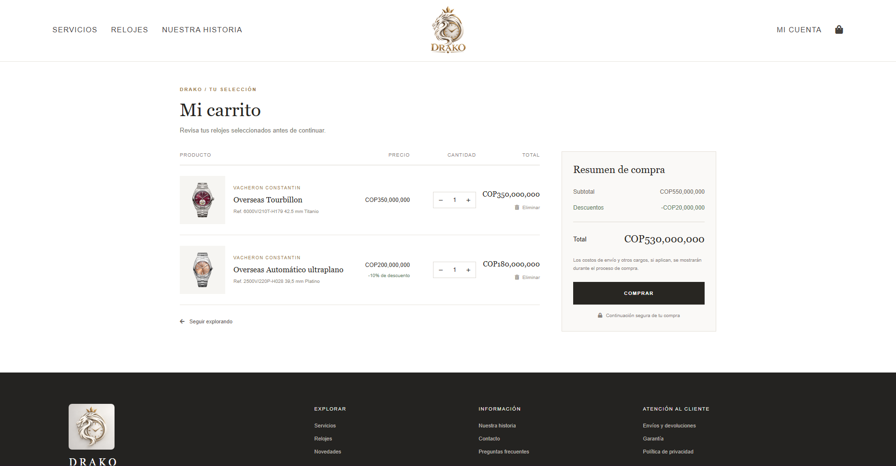
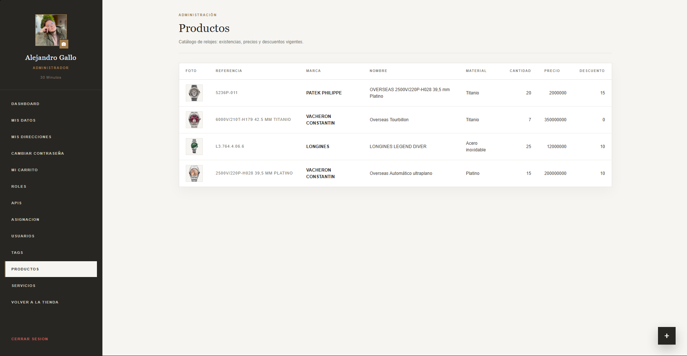

# DRAKO — Full Stack Watch Store

<p align="center">
  A full stack e-commerce application designed for the commercialization and management of watches.
</p>

<p align="center">
  Built with Angular 17, Node.js, Express 5 and MongoDB.
</p>

<p align="center">
  
  
  
  
  
  
</p>

---

## About the Project

DRAKO is a full stack e-commerce application developed for the commercialization of watches.

The project integrates a frontend built with Angular and a backend developed with Node.js and Express, using MongoDB for data persistence.

It was designed to provide an integrated shopping experience, combining product management, user authentication, shopping cart functionality and product administration.

##Screenshots







## Features

- User registration and authentication.
- User account management.
- Product catalog and product filtering.
- Product details.
- Shopping cart management.
- Product image upload and administration.
- REST API integration.
- Database management with MongoDB.

## Technologies

### Frontend

- Angular 17
- TypeScript
- HTML5
- CSS3
- Bootstrap

### Backend

- Node.js
- Express 5
- JavaScript
- Mongoose
- REST APIs

### Database

- MongoDB

### Development and Testing

- Git
- GitHub
- Karma
- Jasmine

### Deployment

- DigitalOcean Droplets

## Project Architecture

DRAKO follows a client-server architecture, separating the frontend application from the backend API.

```text
                 DRAKO
                   |
          +--------+--------+
          |                 |
       Frontend           Backend
       Angular             Express
          |                 |
          |             Controllers
          |                 |
          |               Models
          |                 |
          +---- REST API ---+
                            |
                         MongoDB
```

## Project Structure

```text
DRAKO/
│
├── Frontend/
│   └── Angular application
│
├── Backend/
│   ├── apis/
│   │   ├── controladores/
│   │   └── modelos/
│   │
│   ├── middleware/
│   ├── utils/
│   ├── app.js
│   ├── routes.js
│   └── config.example.js
│
├── .gitignore
└── README.md
```

## Requirements

Before running the project, make sure you have installed:

- Node.js 18 or higher.
- npm.
- MongoDB (local or remote).

## Installation and Setup

### 1. Clone the repository

```bash
git clone https://github.com/Lulo7/DRAKO.git
cd DRAKO
```

### 2. Backend Setup

```bash
cd Backend
npm install
```

Create your local configuration file using the provided example:

```bash
cp config.example.js config.js
```

Configure the required database, email, security, Cloudflare Turnstile and application settings in `config.js`.

Start the backend:

```bash
npm start
```

### 3. Frontend Setup

Open another terminal:

```bash
cd Frontend
npm install
npm start
```

The Angular development server will be available at:

```text
http://localhost:4200
```

## Available Scripts

### Backend

| Command | Description |
|---|---|
| `npm start` | Starts the Express server |

### Frontend

| Command | Description |
|---|---|
| `npm start` | Starts the Angular development server |
| `npm run build` | Builds the application for production |
| `npm run watch` | Builds the application in watch mode |
| `npm test` | Runs unit tests using Karma and Jasmine |

## Security

Sensitive configuration values must remain in the local configuration file and must never be committed to the repository.

Use `config.example.js` as a reference when configuring your local environment.

## Developer

**Javier Alejandro Gallo Lozano**

Full Stack Developer | Backend Developer

- GitHub: [@Lulo7](https://github.com/Lulo7)
- LinkedIn: [Alejandro Gallo](https://linkedin.com/in/alejandro-gallo-webdeveloper/)

## License

This project is licensed under the ISC License.
